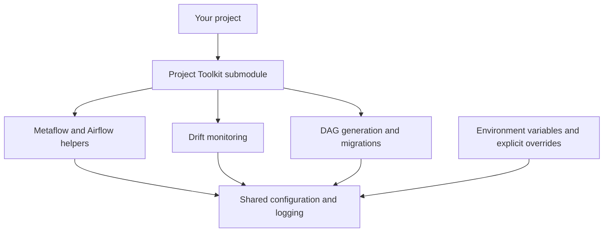

# Project Toolkit

Reusable helpers, scripts, and templates for data pipelines, ML workflows, database migrations, model monitoring, and agent applications.

Designed for reuse across projects through Git submodules or installation. Optional dependency extras keep integration requirements scoped to the projects that use them; configuration is supplied by each project.



Add it to an existing uv project:

```bash
git submodule add https://github.com/Clarenceee/project-toolkit.git reusable
uv export --project reusable --all-extras --no-dev --no-emit-project --no-hashes --output-file /tmp/project-toolkit-dependencies.txt
uv add -r /tmp/project-toolkit-dependencies.txt
PYTHONPATH="$PWD/reusable${PYTHONPATH:+:$PYTHONPATH}" uv run reusable/examples/metaflow_flow.py run
```

Import the helpers directly:

```python
from reusable_helpers.workflows.metaflow.decorators import kubernetes_step

@kubernetes_step()  # Runs locally by default
def start(self):
    self.next(self.end)
```

Explicit arguments override environment variables, then general defaults. Use `.env.example` as a reference; source the settings yourself or use `uv run --env-file .env`. Kubernetes mode needs an image, namespace, and service account. Each project owns its credentials and backend configuration.

Run the synthetic drift example or view the DAG generator options:

```bash
PYTHONPATH="$PWD/reusable" uv run reusable/examples/drift_report.py
PYTHONPATH="$PWD/reusable" uv run reusable/scripts/generate_airflow_dag.py --help
```

The migration script uses the consuming project's `alembic.ini` and migration history:

```bash
PYTHONPATH="$PWD/reusable" uv run reusable/scripts/run_migrations.py
```

Start a PyFlink Kafka project from [the Flink template](templates/flink/README.md).
It keeps its Flink and Python versions in the consuming project's image rather
than adding PyFlink to this toolkit's runtime dependencies.

Deploy that job with the [Flink Helm chart starter](deployment/charts/flink-helm/README.md).
The [deployment base template](deployment/README.md) also provides ArgoCD,
External Secrets, generic Helm, and RayService examples.

Use Python 3.11 or 3.12. The Airflow helpers retain the Notion code's Airflow 2.x interface. DAG generation needs the project's configured Metaflow backend and retains the source script's dictionary-format patches, which fail explicitly if the generated structure differs. Remote workers need the submodule source included in their image or code archive and on their Python import path.

When updating the submodule, repeat the export and `uv add` commands, then commit the new submodule revision together with your project's dependency changes. The exported file is temporary; `pyproject.toml` is the toolkit's dependency source.

For development inside this repo:

```bash
make setup       # all optional integrations and development tools
make format      # Ruff fixes and import sorting, then Black
make check       # Black, Ruff, mypy, Bandit, and unit tests
```

Enable the repository's pre-commit checks once per clone:

```bash
git config core.hooksPath .githooks
```

The hook runs Black in check mode, mypy, and Ruff on staged Python files before each commit. Stage new files with `git add` to include them; it skips checks when no Python files are staged.

Install only the capabilities you use in this repository:

```bash
uv sync --extra agents --extra evaluation --extra mlflow
```

Add any workflow extras you use to that same command: `airflow`, `metaflow`, `drift`, or `migrations`.

The MLflow command line scripts wrap the reusable adapters. The model logger expects an importable MLflow `PythonModel` object:

```bash
python -m scripts.register_mlflow_prompt support prompts/support.txt --commit-message "Add support prompt"
python -m scripts.log_mlflow_agent experiments/support support_agent my_package.model:python_model \
  --code-path my_package --registered-model-name support-agent
```

Tracking configuration follows MLflow's own environment and profile settings. Prompt contents, model construction, credentials, and application policy remain owned by the consuming project.

Dependencies and optional extras live in `pyproject.toml`, with development tools in its `dev` group. Use `uv add <dependency>` or `uv add --dev <tool>` to update dependencies. `make lock` regenerates `uv.lock`; override commands with `make setup PYTHON=3.12` or `make check UV=/path/to/uv`.

See the [generalization playbook](GENERALIZATION_PLAYBOOK.md) when adding reusable code.
